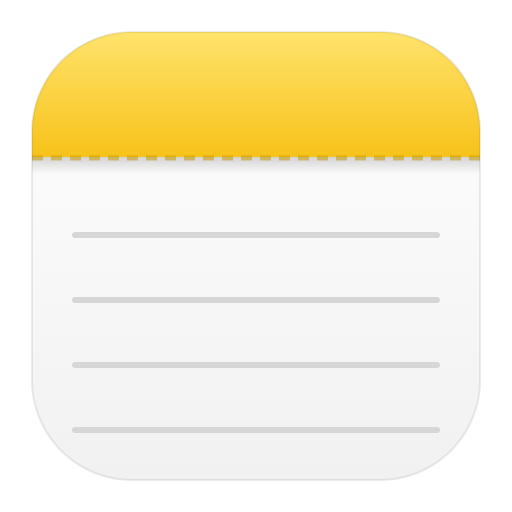

<p align="center">
  
</p>

<h1 align="center">Notas</h1>

<p align="center">Um clone do app Notas do Mac, feito para o Windows.</p>

---

## O problema

O Bloco de Notas do Windows é muito limitado. Ele serve para abrir um `.txt` rápido, mas não organiza nada: não tem pastas, lista de notas, busca entre as notas, checklist nem formatação de verdade. Cada nota vira um arquivo solto que eu tenho que salvar e procurar depois.

Do outro lado, o **Notas do Mac** acerta em cheio. Você abre, escreve e pronto. Tudo fica salvo e organizado em pastas, a primeira linha vira o título, dá para fazer checklist e encontrar qualquer coisa pela busca. Ele é simples sem ser pobre.

Procurei algo assim para o Windows e não achei. Existem bons apps de notas, como o UpNote, o Notesnook e o Joplin, mas nenhum tem essa experiência. Ou são complexos demais, ou têm outra proposta, ou não têm a cara do Notas.

## A minha solução

Decidi construir o meu próprio. Este projeto recria a experiência do Notas do Mac como um app de desktop para Windows:

- **Três colunas**, como no Mac: pastas, lista de notas e editor.
- **A primeira linha vira o título** da nota automaticamente.
- **Salvamento automático**, sem botão de salvar e sem arquivos soltos.
- **Checklist** com as bolinhas amarelas do Notas.
- **Imagens e anexos**: dá para colar um print, arrastar uma foto ou anexar qualquer arquivo pelo clipe. Imagens aparecem dentro da nota; PDFs e outros arquivos viram um cartão que abre com dois cliques.
- **Tabelas**, com opções para adicionar e apagar linhas e colunas.
- **Formatação**: título, cabeçalho, subcabeçalho, listas, negrito, itálico, sublinhado, tachado e texto monoespaçado.
- **Pastas** para organizar (criar, renomear e apagar).
- **Apagadas Recentemente**: nota apagada vai para a lixeira, de onde dá para recuperar. Depois de 30 dias ela some de vez, junto com os anexos.
- **Exportar e importar**: os botões no pé da barra lateral salvam todas as notas (com imagens e anexos) num arquivo `.notas`. No outro computador, é só importar esse arquivo: as notas novas entram e, se a mesma nota existir dos dois lados, fica a versão editada por último. Para levar o arquivo, uso o Google Drive, um e-mail ou um pendrive. Também serve de backup.
- **Menu de contexto**: clique direito numa nota para fixar, mover para outra pasta, duplicar ou apagar. Também dá para arrastar a nota até uma pasta.
- **Ordenação** da lista por data de edição, data de criação ou título.
- **Links**: colo um endereço sobre um texto selecionado e ele vira link; endereços digitados também. Ctrl+clique abre no navegador.
- **Exportar uma nota** como PDF, Markdown ou texto, e **imprimir**, pela paleta de comandos (`Ctrl+Shift+P`).
- **Proteção das notas**: o app salva antes de fechar, só abre uma janela por vez e, se o arquivo de notas for danificado, guarda uma cópia dele em vez de sobrescrevê-lo.
- **Busca** que ignora acentos.
- **Notas fixadas** no topo e lista agrupada por data (Hoje, Ontem, 7 dias…).
- **Visual nativo do Windows 11**, com o efeito Mica na barra lateral e tema claro/escuro automático.

As notas ficam só no meu computador, em `%APPDATA%\Notas\notes.json`, e os anexos na pasta `%APPDATA%\Notas\anexos`. Não tem conta, nuvem nem internet.

## Como foi feito

Eu venho do desenvolvimento web, então escolhi uma stack em que eu reaproveito o que já sei:

- **[Electron](https://www.electronjs.org/)**: transforma uma interface web num app de desktop (é o mesmo que o VS Code, o Discord e o Spotify usam).
- **[React](https://react.dev/)**: a interface.
- **[TipTap](https://tiptap.dev/)**: o editor de texto rico.
- **[Vite](https://vite.dev/)**: o build do frontend.

```
electron/main.cjs     → cria a janela e salva as notas no disco (o "backend" local)
electron/preload.cjs  → a ponte segura entre a interface e o disco
src/App.jsx           → a interface: pastas, lista de notas e editor
src/notes.js          → a lógica das notas (títulos, datas, busca, pastas)
src/editor/           → as extensões do editor (tabelas, imagens, anexos)
src/styles.css        → o visual
tests/                → os testes automáticos
build/icon.svg        → o ícone do app
```

## Baixar

**[⬇️ Baixar o Notas para Windows](https://github.com/lucasbrito0611/bloco-notas-mac/releases/latest/download/Notas-Setup.exe)**

Esse link sempre baixa a versão mais recente. É só abrir o `Notas-Setup.exe` e instalar. Depois disso, você não precisa baixar de novo: quando sai uma versão nova, o app pergunta se você quer atualizar. Se aceitar, ele baixa, instala e abre de novo sozinho. Se preferir deixar para depois, fica um botão **Atualizar** no topo da janela. As versões anteriores ficam na página de [Releases](https://github.com/lucasbrito0611/bloco-notas-mac/releases).

> Na primeira vez, o Windows pode mostrar **"O Windows protegeu o computador"**. Isso acontece porque o instalador não tem assinatura digital paga. Clique em **Mais informações → Executar assim mesmo**.

## Rodando na sua máquina

Você precisa do [Node.js](https://nodejs.org/) instalado.

```bash
git clone https://github.com/lucasbrito0611/bloco-notas-mac.git
cd bloco-notas-mac
npm install
npm start
```

Para rodar os testes:

```bash
npm test
```

Para desenvolver com recarga automática:

```bash
npm run dev
```

## Atalhos

### Geral e navegação

| Atalho | Ação |
|---|---|
| `Ctrl+N` | Nova nota |
| `Ctrl+Shift+N` | Nova pasta |
| `Ctrl+P` | Ir rápido para uma nota |
| `Ctrl+Shift+P` | Paleta de comandos |
| `Ctrl+F` | Localizar na nota |
| `Ctrl+H` | Localizar e substituir na nota |
| `Ctrl+Shift+F` | Buscar em todas as notas |
| `F3` / `Shift+F3` | Próxima / anterior ocorrência na nota |
| `Ctrl+\` | Mostrar ou esconder a barra de pastas |
| `Ctrl+1` / `Ctrl+2` / `Ctrl+3` | Focar Pastas / Lista de notas / Editor |
| `Alt+←` / `Alt+→` | Voltar / avançar no histórico de notas |
| `Ctrl+PageUp` / `Ctrl+PageDown` | Nota anterior / próxima na lista |
| `Ctrl+=` / `Ctrl+-` / `Ctrl+0` | Aumentar / diminuir / redefinir zoom do editor |
| `F2` ou duplo clique na pasta | Renomear pasta |
| `Ctrl+Alt+P` | Imprimir a nota |
| `Ctrl+clique` num link | Abrir o link no navegador |

### Edição de linhas e blocos

| Atalho | Ação |
|---|---|
| `Alt+↑` / `Alt+↓` | Mover linha ou bloco para cima / baixo |
| `Alt+Shift+↑` / `Alt+Shift+↓` | Duplicar linha ou bloco acima / abaixo |
| `Ctrl+Shift+K` | Apagar linha |
| `Ctrl+L` | Selecionar linha inteira (repita para estender) |
| `Ctrl+Enter` / `Ctrl+Shift+Enter` | Inserir linha abaixo / acima |
| `Ctrl+C` / `Ctrl+X` *(sem seleção)* | Copiar / recortar a linha inteira |
| `Ctrl+]` / `Ctrl+[` | Aumentar / diminuir recuo |
| `Alt+Shift+→` / `Alt+Shift+←` | Expandir / encolher seleção |

### Múltiplos cursores e ocorrências

| Atalho | Ação |
|---|---|
| `Ctrl+D` | Selecionar palavra / próxima ocorrência igual |
| `Ctrl+K` depois `Ctrl+D` | Pular a ocorrência atual para a seguinte |
| `Ctrl+Alt+L` | Selecionar todas as ocorrências iguais |
| `Ctrl+Alt+↑` / `Ctrl+Alt+↓` | Adicionar cursor acima / abaixo |
| `Alt+Clique` | Adicionar cursor onde clicar |
| `Alt+Shift+I` | Colocar um cursor no fim de cada linha selecionada |
| `Ctrl+Alt+U` | Desfazer último cursor adicionado |
| `Esc` | Voltar para um único cursor |

### Formatação

| Atalho | Ação |
|---|---|
| `Ctrl+B` / `Ctrl+I` / `Ctrl+U` | Negrito / Itálico / Sublinhado |
| `Ctrl+Shift+S` | Tachado |
| `Ctrl+E` | Código inline |
| `Ctrl+Alt+C` | Bloco de código |
| `Ctrl+Shift+B` | Citação |
| `Ctrl+Shift+L` ou `Ctrl+Shift+9` | Lista de verificação |
| `Ctrl+Shift+7` / `8` | Lista numerada / com marcadores |
| `Ctrl+Alt+0`..`3` | Texto normal / Título / Subtítulo / Subseção |

## Como eu lanço uma versão nova

Cada versão vira um instalador automaticamente pelo GitHub Actions. Antes de gerar o instalador, ele roda os testes: se algum falhar, nada é publicado.

```bash
npm version patch
```
```bash
git push --follow-tags
```

O GitHub gera o `.exe`, publica nos Releases, e quem já tem o app instalado recebe um aviso para atualizar.

## Ícone

O ícone fica em `build/icon.svg`. Depois de editar, rode `npm run icon` para gerar o `icon.ico` e o `icon.png`.

## Próximos passos

- [x] Instalador `.exe` com atualização automática
- [x] Imagens e anexos nas notas
- [x] Tabelas
- [x] Lixeira ("Apagadas Recentemente")
- [x] Exportar e importar as notas num arquivo `.notas`
- [x] Menu de contexto, mover notas entre pastas, duplicar e ordenar
- [x] Links, exportar uma nota (PDF, Markdown, texto) e imprimir
- [x] Proteção contra perda de notas (salvar ao fechar, cópia do arquivo danificado)
- [ ] Sincronização entre computadores

---

Este é um projeto pessoal, sem relação com a Apple. O ícone e a interface foram feitos do zero, inspirados no Notas.
